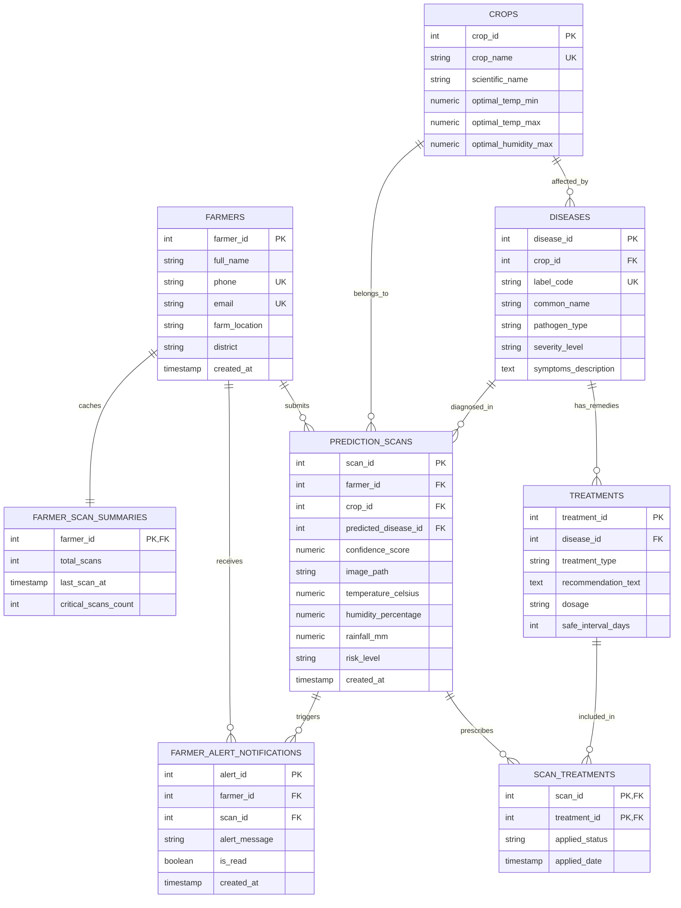

# 01. DBMS Overview & System Architecture

## 1. Executive Summary & Problem Context

In modern smart agriculture, an Artificial Intelligence (AI) model running on image recognition (such as a Convolutional Neural Network or Vision Transformer) solves only the **identification phase** of crop pathology. An AI model receives an image and outputs a classification label (e.g., `Tomato___Early_blight`) with a confidence score (e.g., `94.2%`).

However, an AI model alone **cannot** maintain state, track longitudinal disease spread, trigger legal chemical advisory limits, enforce referential integrity across agricultural stakeholders, or guarantee transactional reliability. 

This is where the **Relational Database Management System (RDBMS)** serves as the operational backbone of the **AI-Driven Crop Disease Prediction and Management System**.

---

## 2. Dual-Engine Architecture: AI Engine vs. DBMS Engine

The system operates via a tightly coupled **Dual-Engine Architecture**:

```
+-----------------------------------------------------------------------------------+
|                                  USER / CLIENT TIER                               |
|                (React Frontend Web / Progressive Web Application)                 |
+-----------------------------------------------------------------------------------+
                                        | (HTTPS / REST API)
                                        v
+-----------------------------------------------------------------------------------+
|                             APPLICATION / SERVER TIER                             |
|                             (Node.js / Express Server)                            |
+-----------------------------------------------------------------------------------+
             |                                                  |
             | 1. Image Stream                                  | 2. Parameterized SQL
             v                                                  v
+-----------------------------+                    +--------------------------------+
|       AI INFERENCE ENGINE   |                    |       DBMS PERSISTENCE ENGINE  |
|       (TensorFlow.js)       |                    |       (SQLite / PostgreSQL)    |
|                             |                    |                                |
| • Image Preprocessing (224x)|                    | • Farmers & Crops Master Data  |
| • Deep CNN Forward Pass     |                    | • Diseases & Treatments Catalog|
| • Class Probabilities       |                    | • ACID Scan Transactions Logs  |
| • Disease Label Output      |                    | • Outbreak Alerts & Analytics  |
+-----------------------------+                    +--------------------------------+
             |                                                  |
             +----------------> Aggregated Payload <------------+
                                        |
                                        v
                    Actionable Farmer Advisory & Risk Alert
```

### Why DBMS is Crucial for AI Projects:
1. **Longitudinal Record-Keeping:** Farmers can track disease progression over weeks or growing seasons.
2. **Context Enrichment:** The DBMS combines raw AI labels with microclimate factors (temperature, humidity, rainfall) to compute dynamic risk levels.
3. **Prescriptive Treatment Routing:** Links AI disease codes to verified agricultural treatments, dosage guidelines, and safe pre-harvest intervals.
4. **Epidemiological Surveillance:** Powers aggregate SQL queries for agricultural scientists and district officers to identify disease hotspots.
5. **ACID Guarantees:** Ensures that whenever an image is analyzed, the prediction, treatment linking, and emergency notifications are committed atomically.

---

## 3. Entity-Relationship (ER) Diagram

The relational schema consists of 8 interconnected tables with enforced primary keys, foreign keys, CHECK constraints, and indexes:



---

## 4. Cardinality & Relationship Breakdown

| Entity 1 | Relationship | Entity 2 | Cardinality | Explanation |
| :--- | :---: | :--- | :---: | :--- |
| **`farmers`** | 1 to Many | **`prediction_scans`** | $1 : N$ | One farmer can perform multiple image scans over time. Each scan belongs to exactly one farmer. |
| **`crops`** | 1 to Many | **`diseases`** | $1 : N$ | One crop (e.g., Tomato) can suffer from multiple diseases (Early Blight, Late Blight, Leaf Mold, Bacterial Spot). |
| **`diseases`** | 1 to Many | **`treatments`** | $1 : N$ | One disease has multiple treatment options (Chemical, Organic, Cultural, Preventive). |
| **`prediction_scans`** | Many to Many | **`treatments`** | $M : N$ | A scan can result in multiple prescribed treatments, and a treatment can be applied across many scans. Resolved by `scan_treatments`. |
| **`prediction_scans`** | 1 to Many | **`farmer_alert_notifications`** | $1 : N$ | A critical scan automatically generates outbreak alerts for the farmer and regional monitors. |
| **`farmers`** | 1 to 1 | **`farmer_scan_summaries`** | $1 : 1$ | Controlled denormalization cache storing quick stats per farmer to avoid expensive runtime `COUNT(*)` queries on login. |

---

## 5. Referential Integrity & Deletion Rules

1. **`ON DELETE CASCADE`** on `farmer_id`:
   - If a test farmer account is deleted, all associated `prediction_scans`, `farmer_alert_notifications`, and `farmer_scan_summaries` are automatically purged to prevent orphan rows.
2. **`ON DELETE RESTRICT`** on `crops` and `diseases`:
   - Deleting a crop or disease from the master catalog is blocked if active historical scan logs reference that ID. This guarantees audit compliance.
3. **`PRAGMA foreign_keys = ON;`**:
   - Explicitly enabled upon opening the SQLite connection in [`backend/db.js`](file:///Users/sk/ASD-PROJECT/AI-Driven-Crop-Disease-Prediction-and-Management-System/backend/db.js#L16) so that the embedded engine strictly validates relational pointers.
